<p align="center">
  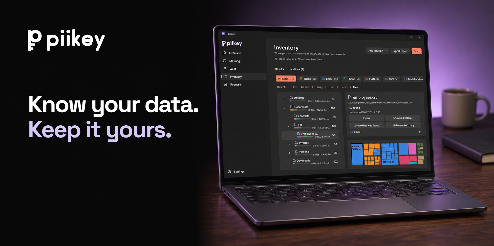
</p>

<p align="center">
  <strong>Find, flag and mask your personal data, everywhere on your PC. Local, fast, always in the background.</strong>
</p>

<p align="center">
  <a href="https://github.com/TBLgGamin/piikey/releases/latest"><strong>Download for Windows</strong></a>
  &middot;
  <a href="#quick-start">Install</a>
  &middot;
  <a href="docs/how-it-works.md">Documentation</a>
  &middot;
  <a href="https://tblggamin.github.io/piikey/">API reference</a>
  &middot;
  <a href="https://github.com/TBLgGamin/piikey/releases">Releases</a>
</p>

<p align="center">
  <a href="https://github.com/TBLgGamin/piikey/actions/workflows/ci.yml"></a>
  <a href="https://github.com/TBLgGamin/piikey/releases/latest"></a>
  <a href="https://github.com/TBLgGamin/piikey/releases"></a>
  <a href="LICENSE"></a>
  <a href="#quick-start"></a>
  <a href="rust-toolchain.toml"></a>
</p>

---

piikey finds names, email addresses, phone numbers, IBANs, card numbers, addresses and other
personal data on your PC and puts you in charge of it. It masks what you send to the sites and apps
you choose, outlines what you type, maps where personal data is stored in your folders and cloud
accounts, and finds everything on record about one person. *You ask ChatGPT about "my manager Mark
Jansen"; chatgpt.com reads "Kevin Wolters", and the answer comes back saying Mark Jansen.*

It is a Windows app that lives in the tray, with a command line and a local JSON API next to it.
Detection (validated patterns plus an on-device model), the stand-ins and the encrypted vault that
remembers them all stay on your machine. There is no piikey cloud service, no account and no browser
extension.

<picture>
  <source media="(prefers-color-scheme: dark)" srcset="docs/assets/hero-dark.png">
  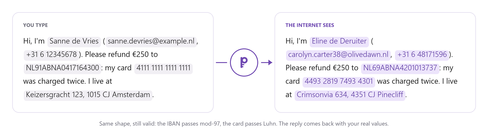
</picture>

The masked message above is real `piikey-cli anonymize` output, and the reply is turned back by
`piikey-cli deanonymize --tolerant`: full names, the lone first name and the phone number all come
back as yours.

## Table of contents

- [Features](#features)
- [Quick start](#quick-start)
- [Usage](#usage)
- [Configuration](#configuration)
- [How it works](#how-it-works)
- [Accuracy and speed](#accuracy-and-speed)
- [Development](#development)
- [Contributing](#contributing)
- [Security and privacy](#security-and-privacy)
- [Acknowledgements](#acknowledgements)
- [License](#license)

## Features

- **Masking for sites and apps.** What you type or paste into a protected site or app is swapped
  for a believable stand-in of the same shape before it leaves your PC, and your real values are put
  back into the answer, streamed replies included. Typos and lone first names come back too.
- **Live highlight.** The field you are typing in gets a purple outline when it holds personal data,
  in any app, always or when you press Ctrl+Alt+P. Nothing is stored.
- **Inventory.** Scan your folders and see where personal data is stored, in a dashboard like a
  disk-usage viewer: a tree of your real folders from the drives down, a legend of types, and a
  treemap with a tile for every file. Nothing is scanned until you ask, and a rescan reads only what
  changed.
- **Monitor.** Switch it on for a location and piikey looks at a file again a moment after it
  changes. A monitored cloud location is asked what changed every 5 minutes.
- **Cloud locations.** Connect Microsoft 365 (SharePoint and OneDrive for work or school),
  OneDrive, Google Drive, Dropbox or Box and scan a folder there like one on this PC: read-only,
  into memory, never stored. [How to connect each provider](docs/sources.md).
- **What was found, and where.** Every value of a file or folder with its type, the text around it
  and its place (`line 12`, `page 3`, `Sheet1, cell B7`, `slide 4`). **Open at this place** opens the
  file at the value. Values are read when you ask and never stored.
- **Find on record.** Type a name, email address, phone number or IBAN and see what the vault keeps
  and every place your locations hold it, in any letter case and spacing. For a request for access
  (GDPR Art. 15) it shows when the answer is due and exports a report to answer from.
- **"Scan for personal data" in Explorer.** Right-click a file or folder (under Show more options
  on Windows 11); the result opens in piikey.
- **An encrypted vault you control.** Search, filter, export to CSV and forget. Forgetting rewrites
  the file, so the value is gone from disk. Records are sealed with XChaCha20-Poly1305 under a key
  Windows DPAPI protects.
- **Documents, PDFs, images and mail.** DOCX, XLSX, PPTX and ODF (rewritten in place), PDF, images
  through Windows OCR, and `.eml`/`.msg`.
- **An on-device model.** Validated patterns (IBAN mod-97, Luhn, Dutch BSN, JWTs and more) plus a
  multilingual token classifier for names, addresses, IDs and the GDPR special categories in 24 EU
  languages. It runs on the CPU, and the GPU joins in through DirectML for large batches.
- **One API, one CLI.** Everything piikey does is a JSON operation on a named pipe and, if you
  switch it on, a token-protected HTTP port on 127.0.0.1. Each operation is a `piikey-cli`
  subcommand, and `scan --fail-on` fails a commit or a build that contains personal data.
- **Nothing leaves your PC.** The project's own code is 100% safe Rust (`unsafe` is forbidden).

## Quick start

### Prerequisites

- Windows 10 or 11, x64.
- About 350 MB of disk for the detection model, downloaded on first start.

### Installation

Download from the [latest release](https://github.com/TBLgGamin/piikey/releases/latest):

| File | What it is |
|---|---|
| `piikey-<version>-setup-x64.exe` | Installer. Installs for your user only, without admin rights, to `%LOCALAPPDATA%\Programs\piikey`, with a Start-menu entry and an uninstaller. |
| `piikey-<version>-windows-x64.zip` | Portable. Unzip anywhere and run `piikey\piikey.exe`. |
| `SHA256SUMS.txt` | Hashes of the assets of that release. |

The builds are not code-signed yet, so Windows SmartScreen asks once: choose **More info**, then
**Run anyway**.

Verify a download against `SHA256SUMS.txt`, and its build provenance attestation (every asset is
attested as built from this repository by GitHub Actions):

```powershell
Get-FileHash .\piikey-0.1.0-setup-x64.exe -Algorithm SHA256
gh attestation verify piikey-0.1.0-setup-x64.exe --repo TBLgGamin/piikey
```

### First run

1. piikey downloads its detection model (about 343 MB, checked with SHA-256) to
   `%LOCALAPPDATA%\piikey\models`.
2. On **Overview**, install the certificate with the banner's button (Windows asks once).
3. On **Masking**, tick your sites under Sites.
4. Back on **Overview**, turn protection on.

For the inventory, open **Inventory** and add a location (Folder..., File... or, with a connected
account, Cloud folder...), then Scan.

### Uninstall

Settings > Apps, or the Start menu. The uninstaller stops piikey, gives Windows its proxy settings
back, and removes the start-at-sign-in entry and the local certificate. It then asks before it
deletes your data in `%LOCALAPPDATA%\piikey`. Keep that data if you still want earlier stand-ins to
come back as your values.

## Usage

### The app

`piikey.exe` is one window with a pane on its left and a tray icon. Pages are laid out like Windows
Security and Windows Settings: content on cards, one closable message at the top when something
needs saying.

| Page | What it does |
|---|---|
| **Overview** | Whether personal data is safe right now. A banner with the status and its one button (the fix when something needs you, else Turn on or Turn off), a tile per protection area that opens its page, and the five latest swaps. |
| **Masking** | The Masking switch and how highlighting behaves (off, always, or Ctrl+Alt+P). **Sites** and **Apps** cards open to the protected sites and apps, with a box to add one; for an app, type its name or pick a running one. |
| **Vault** | Every value next to its stand-in, its type, where it went and when, newest first. Search, filters by type, site and time, Select all, **Forget N** after a confirmation, and Export... to a CSV in Downloads (which holds the values themselves, so keep it safe). |
| **Inventory** | Add location, Export report and Scan, with a status line. **Results** is the dashboard: types, a breadcrumb, the folder tree with a bar by type on each row, the details of the selection (Open, Show in Explorer, Show what was found, Make masked copy beside the file) and the treemap. **Locations** lists each location with what it holds, a **Monitor** switch and Remove, a card to add one by path, and the **Cloud accounts**. Drop files and folders from Explorer onto the page. |
| **What was found** | Takes the page's place, with a back button in the title bar. Lists every value as the files are read, with search, type chips and a file filter, and **Open at this place**: VS Code, Notepad++ and Sublime Text go to the line, other apps Windows can read select the value and outline it for two seconds, the rest just open the file. |
| **Requests** | Find on record for one person: the values (one a line), where to look and the day a request came in (shows when the answer is due: one month, or three with the extension). Results, **In the vault** and **In files** follow; Export report writes a summary, CSV and JSON to a new folder in Downloads. The last search stays in memory until piikey closes. |
| **Settings** | General (start at sign-in, the Explorer menu entry, keep running in the tray), Types of personal data (a check box per type, by group), Developer access (the local HTTP API switch, the API reference, the token), Privacy & data (the data folder) and About. A card for the detection model appears only when it was skipped or failed. |

A scan from the page, a drop or Explorer ends in a **result dialog**: a bar per file while it runs,
then what was found by type, with Close and Show what was found. Closing it while it runs stops the
scan. The inventory keeps only what lies in your locations; a file scanned from outside them still
shows its result, and is forgotten from the inventory right after.

The **tray icon** shows the same status as the Overview banner: the key in grey while protection is
off, the app icon while it is on, an amber dot when it needs you. Its menu has Open piikey, Turn
protection on or off, and Quit piikey. With "Keep piikey running in the tray when I close the
window" on (the default), closing the window leaves protection, highlighting, monitoring and the API
working. Starting piikey again brings the window forward instead of a second copy (`piikey-cli open`
does the same), and with "Start piikey when I sign in" it starts in the tray without a window.

<table>
  <tr>
    <td colspan="2">
      <picture>
        <source media="(prefers-color-scheme: dark)" srcset="docs/assets/screenshots/overview-dark.png">
        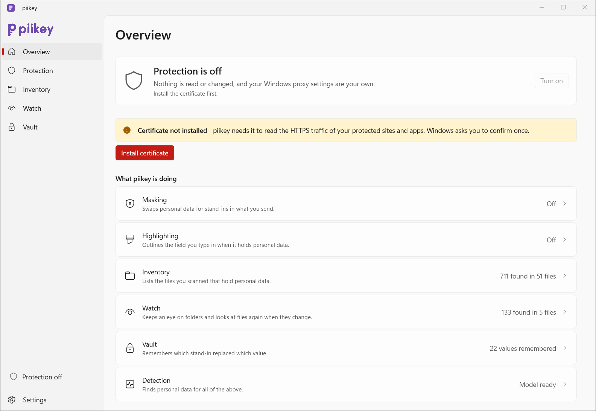
      </picture>
    </td>
  </tr>
  <tr>
    <td width="50%">
      <picture>
        <source media="(prefers-color-scheme: dark)" srcset="docs/assets/screenshots/masking-dark.png">
        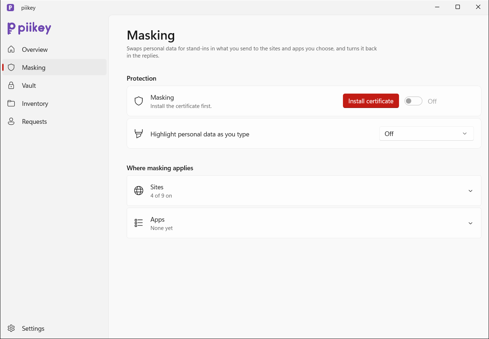
      </picture>
    </td>
    <td width="50%">
      <picture>
        <source media="(prefers-color-scheme: dark)" srcset="docs/assets/screenshots/vault-dark.png">
        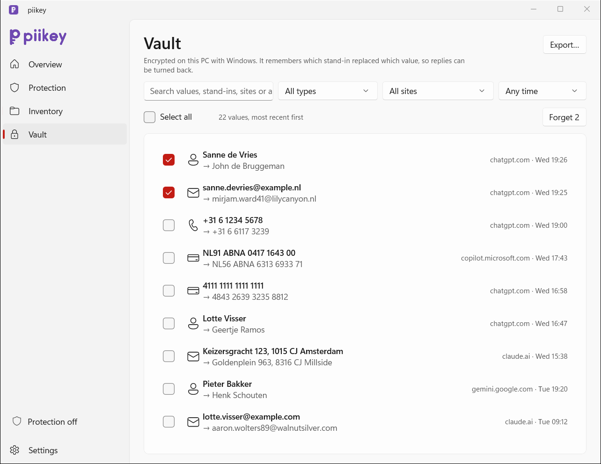
      </picture>
    </td>
  </tr>
  <tr>
    <td width="50%">
      <picture>
        <source media="(prefers-color-scheme: dark)" srcset="docs/assets/screenshots/inventory-dark.png">
        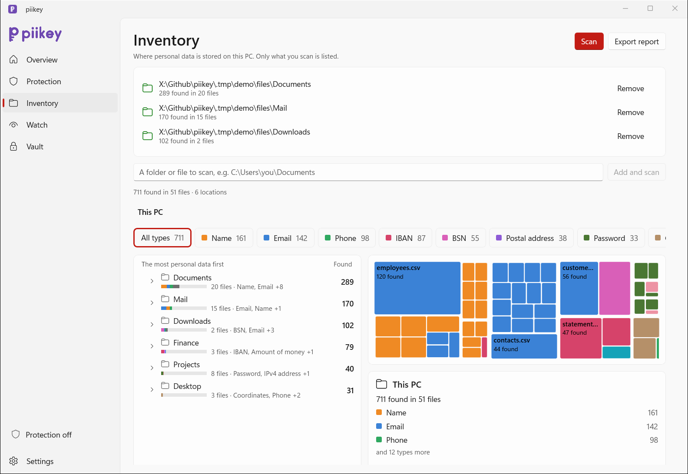
      </picture>
    </td>
    <td width="50%">
      <picture>
        <source media="(prefers-color-scheme: dark)" srcset="docs/assets/screenshots/locations-dark.png">
        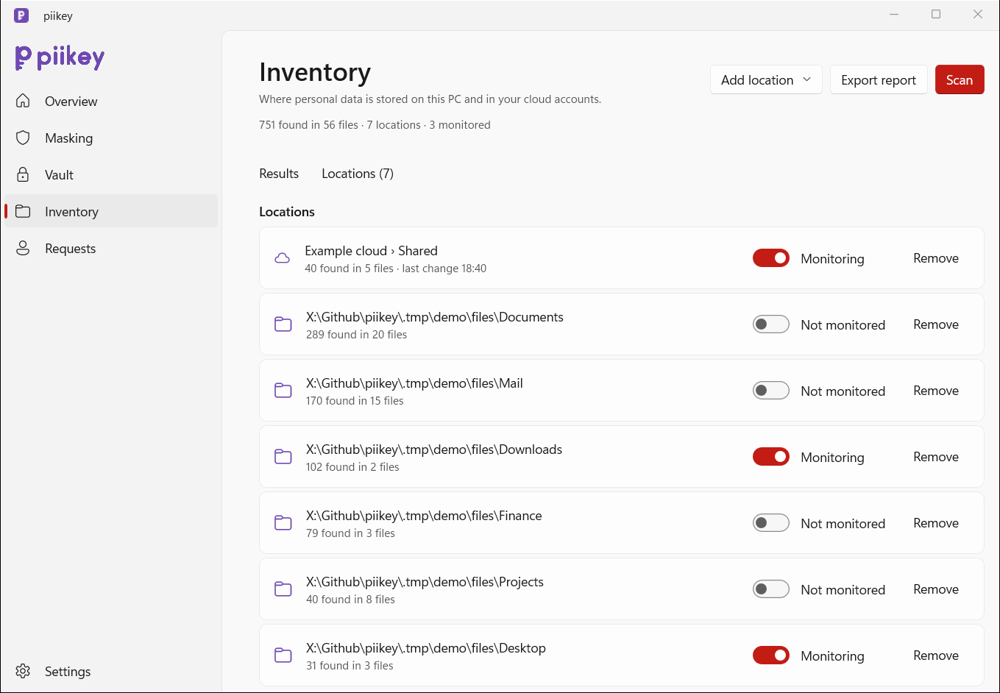
      </picture>
    </td>
  </tr>
  <tr>
    <td width="50%">
      <picture>
        <source media="(prefers-color-scheme: dark)" srcset="docs/assets/screenshots/requests-dark.png">
        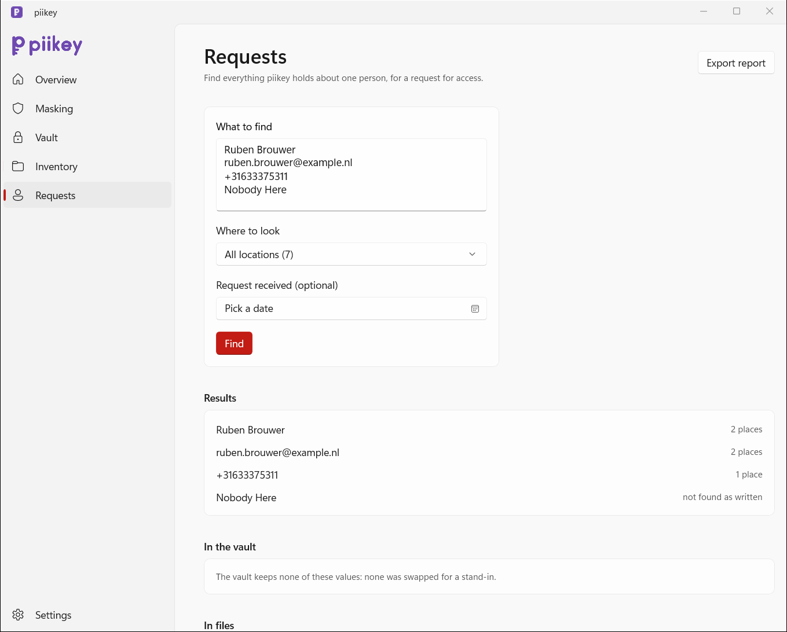
      </picture>
    </td>
    <td width="50%">
      <picture>
        <source media="(prefers-color-scheme: dark)" srcset="docs/assets/screenshots/settings-dark.png">
        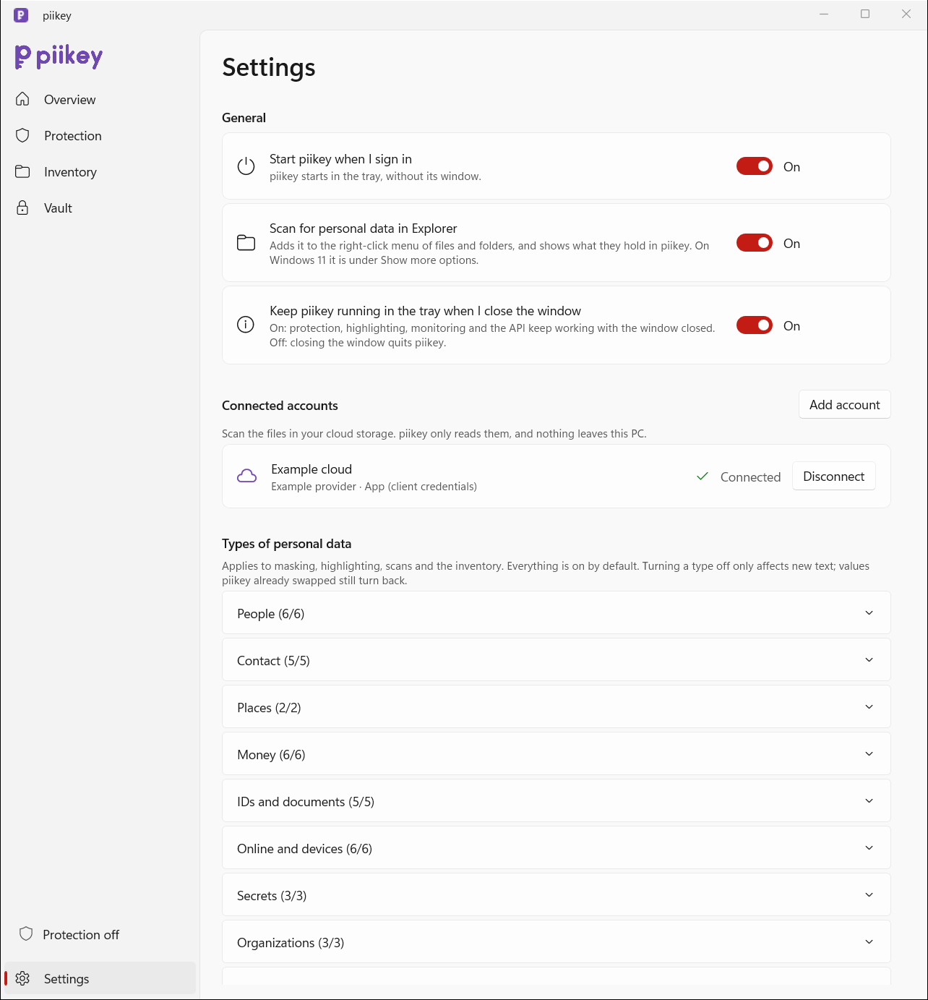
      </picture>
    </td>
  </tr>
  <tr>
    <td width="50%">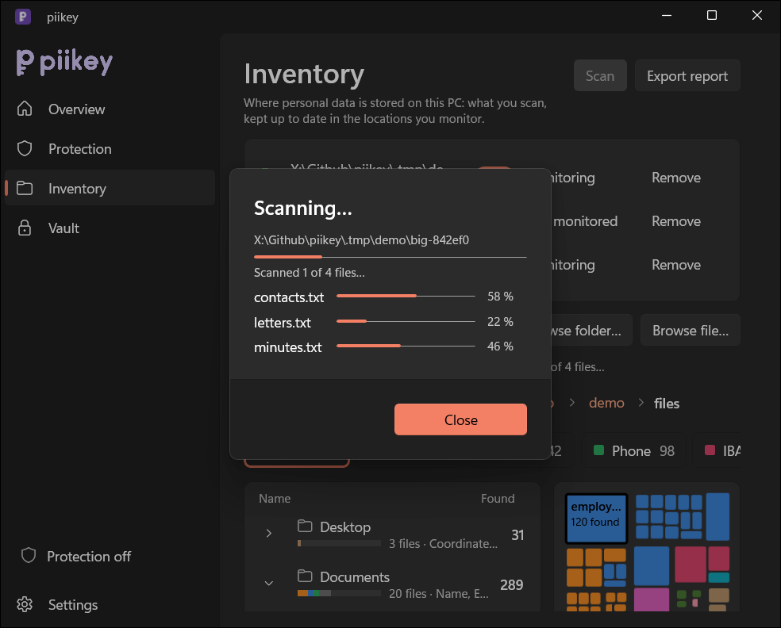</td>
    <td width="50%">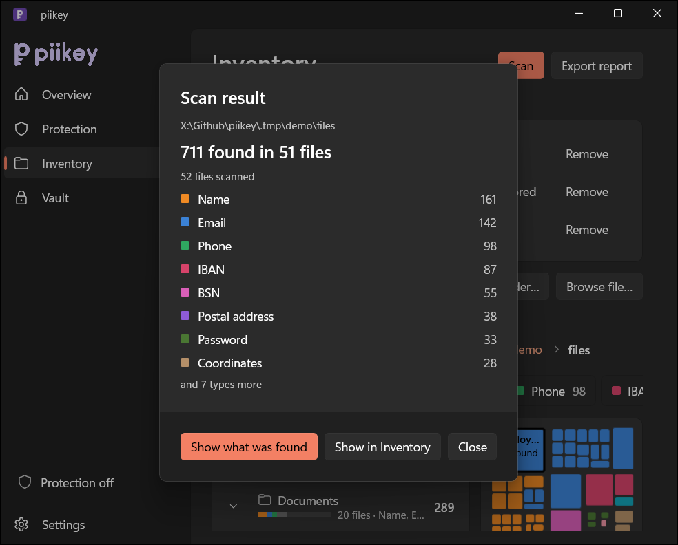</td>
  </tr>
  <tr>
    <td colspan="2">
      <picture>
        <source media="(prefers-color-scheme: dark)" srcset="docs/assets/screenshots/findings-dark.png">
        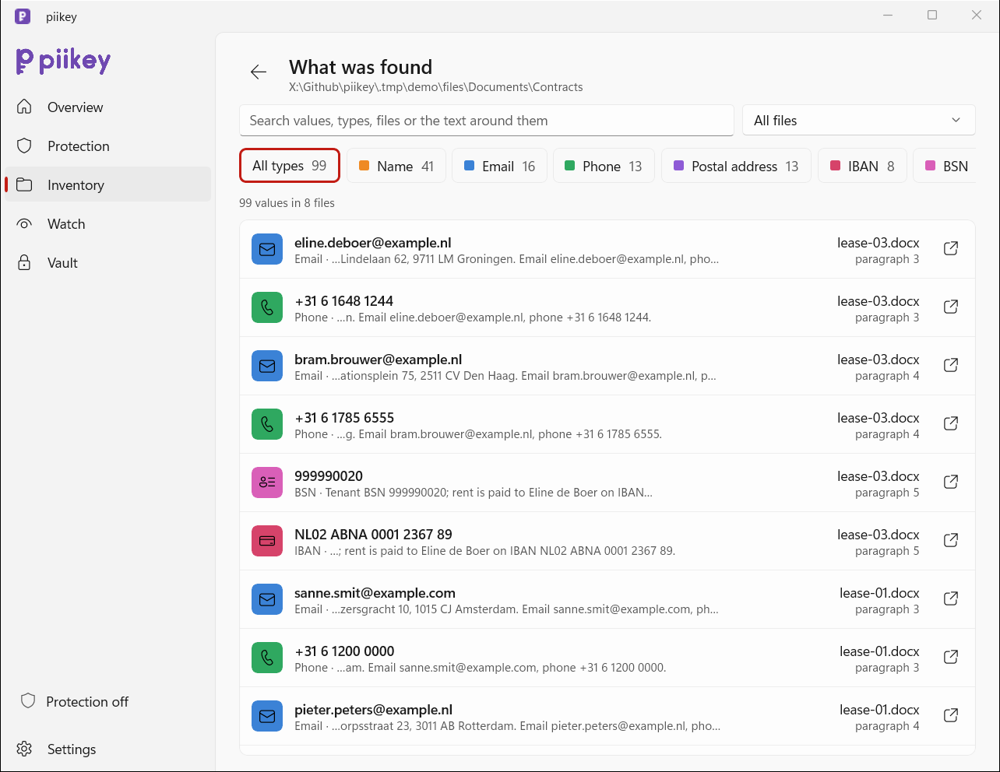
      </picture>
    </td>
  </tr>
</table>

### Command line

`piikey-cli.exe` ships next to the app and has one subcommand per API operation:

```
piikey-cli scan [--fail-on KINDS|any] [--no-record] [PATH...]        no PATH: stdin text
piikey-cli anonymize [--out DIR] [PATH...]                            no PATH: stdin -> stdout
piikey-cli deanonymize [--tolerant] [--out DIR] [PATH...]
piikey-cli subject --value V [--value V ...] [PATH...]
piikey-cli vault list [--query Q] [--kind KIND] [--limit N] [--offset N]
piikey-cli vault forget VALUE...
piikey-cli vault export --out FILE [--format json|csv]
piikey-cli vault wipe --yes
piikey-cli inventory status | list [--under PATH] [--limit N] [--offset N] | tree [--under PATH] | rescan | report --out FILE [--format json|csv]
piikey-cli settings get | settings set KEY=VALUE...      keys = guard.cfg keys; list keys repeat (site=a site=b)
piikey-cli account list | connect ID | remove ID --yes | browse ID [--under PATH]
piikey-cli account add PROVIDER --label NAME [--mode MODE] [--tenant T] [--client-id ID] [--app-key KEY] [--key-file FILE] [--cert-file FILE] [--site URL ...] [--user EMAIL ...] [--enterprise-id ID | --user-id ID] [--client-secret-stdin]
piikey-cli kinds | model status | model download | token [--rotate] | status | protection on|off
piikey-cli open      brings the running app's window forward (needs the app)
piikey-cli serve [--http [--port N]] [--pipe NAME]
global: --json  --local  --vault PATH  -h/--help  -V/--version
```

| What | How it behaves |
|---|---|
| Paths | `anonymize` and `deanonymize` with paths need `--out DIR`; folders are walked recursively, symbolic links skipped. Relative paths are made absolute, so the app answers for the same files. |
| Stdin | With no path, `scan`, `anonymize` and `deanonymize` read UTF-8 text from stdin; the last two write the result to stdout, line breaks and all. Give other encodings and documents as paths. |
| `--tolerant` | Also restores stand-ins that came back with a typo, and first or last names that came back alone. |
| `subject` | Lists the files that mention the given values, as a whole word in any letter case or spelled another way (`+31 6 1234 5678` matches `+31612345678`). With no PATH it searches the inventory's locations. |
| `--json` | Prints the result, or an error as `{"code": ..., "message": ...}`, as JSON instead of a table. |
| Where it runs | The CLI asks the running app over the pipe first. `--local` works in its own process on `%LOCALAPPDATA%\piikey\vault.pkv` (readable only by the Windows user who created it); `--vault PATH` uses the vault at PATH; `serve` serves the API from the terminal. Without the app, `protection`, `explorer_scan` and `show_window` answer `app_required`. |
| Model | Used once downloaded (`model download`, or the app does it); until then only patterns are found. Types switched off in Settings are off here too. |
| Exit codes | 0 success, 1 personal data found under `--fail-on`, 2 usage error, 3 any API error. |

Run `piikey-cli --help` for every option.

#### Pre-commit and CI gate

`scan --fail-on any` exits 1 when a file holds personal data; `--fail-on email,iban` limits it to
those types (see `piikey-cli kinds`). `--no-record` keeps the scan out of the inventory.

```sh
#!/bin/sh
# .git/hooks/pre-commit
git diff --cached --name-only -z --diff-filter=ACM | xargs -0 piikey-cli scan --local --no-record --fail-on any
```

GitHub Actions on a Windows runner. Without the model this checks patterns only (emails, phone
numbers, IBANs, cards and so on); add a `piikey-cli.exe model download` step (about 340 MB, cache
the model folder) to find names, places and the other types only the model sees.

```yaml
- name: Download piikey
  shell: pwsh
  env:
    GH_TOKEN: ${{ github.token }}
  run: |
    gh release download --repo TBLgGamin/piikey --pattern 'piikey-*-windows-x64.zip' --dir $env:RUNNER_TEMP
    Expand-Archive "$env:RUNNER_TEMP\piikey-*-windows-x64.zip" -DestinationPath $env:RUNNER_TEMP
- name: Scan for personal data
  shell: bash
  run: git ls-files -z | xargs -0 "$RUNNER_TEMP/piikey/piikey-cli.exe" scan --local --no-record --fail-on any
```

### HTTP API

Everything piikey does is one JSON API, served on a named pipe and, once you switch on "Local HTTP
API" in Settings > Developer access, on `http://127.0.0.1:7980`. The reference is generated from
the code: [`docs/api/README.md`](docs/api/README.md), the interactive page at
https://tblggamin.github.io/piikey/, or the OpenAPI 3.1 file
[`docs/api/openapi.json`](docs/api/openapi.json). The running app also serves the spec at
`GET /v1/openapi.json` without a token, so Postman and Insomnia can import it from that URL.

| Transport | How to call it |
|---|---|
| HTTP | `POST /v1/<op>` with the request's fields as the JSON body (without `op`; `GET /v1/status` also works) and a bearer token from `piikey-cli token`. Loopback only; requests with an `Origin` header are refused, so web pages cannot call it. Statuses 200, 400, 401, 403, 404, 405, 409, 413 or 500. |
| Named pipe | `\\.\pipe\piikey-<USERNAME>` (characters other than letters, digits, `.`, `_` and `-` become `_`), local clients only. A request is the bytes `P`, `2`, `0`, `0`, a `u32` little-endian length, then the request JSON, e.g. `{"op": "scan_text", "texts": ["mail jan@acme.nl"]}`. The reply is a status byte (0 ok, 1 error), three zero bytes, a `u32` little-endian length and the envelope. Version 1 (binary) is no longer accepted. |
| Replies | `{"ok": true, "result": ...}` or `{"ok": false, "error": {"code": "...", "message": "..."}}`. Codes: `bad_request`, `app_required`, `not_found`, `busy`, `io`, `vault`, `unsupported`, `model`, `internal`. |

```sh
curl -H "Authorization: Bearer $(piikey-cli token)" \
     -d '{"texts":["mail jan@acme.nl"]}' http://127.0.0.1:7980/v1/scan_text
# {"ok":true,"result":{"results":[[{"start":5,"end":16,"kind":"email","value":"jan@acme.nl"}]]}}
```

```python
import json
import subprocess
import urllib.request

token = subprocess.check_output(["piikey-cli", "token"], text=True).strip()
request = urllib.request.Request(
    "http://127.0.0.1:7980/v1/scan_text",
    data=json.dumps({"texts": ["mail jan@acme.nl"]}).encode(),
    headers={"Authorization": f"Bearer {token}", "Content-Type": "application/json"},
)
with urllib.request.urlopen(request) as reply:
    print(json.load(reply)["result"]["results"])
```

## Configuration

Settings live in `%LOCALAPPDATA%\piikey\guard.cfg`, one `key=value` per line. The app's Settings and
Masking pages write it; `piikey-cli settings set KEY=VALUE` and the API's `settings_set` change it
too. List keys repeat (`site=a site=b`).

| Key | Default | Purpose |
|---|---|---|
| `enabled` | `false` | Protection (masking) on or off. |
| `highlight` | `hotkey` | The live highlight: `off`, `always`, or `hotkey` (Ctrl+Alt+P). |
| `explorer_menu` | `true` | The "Scan for personal data" entry in Explorer's right-click menu. |
| `background` | `true` | Closing the window keeps piikey running in the tray. |
| `http_api` | `false` | The local HTTP API. |
| `http_port` | `7980` | Its port, on 127.0.0.1. |
| `site` | none | A protected site, e.g. `chat.openai.com` or `*.anthropic.com`. |
| `program` | none | A protected app by exe name, e.g. `chrome.exe`. |
| `disabled_kind` | none | A type of personal data not to look for (see `piikey-cli kinds`). |
| `inventory_root` | none | A location of the inventory: a folder, a file or a cloud folder. |
| `monitor_root` | none | A location whose changes are scanned as they happen; must also be an `inventory_root`. |

Everything else piikey keeps is in `%LOCALAPPDATA%\piikey` as well: the vault (`vault.pkv`), the
inventory (`inventory.jsonl`), the swaps list (`activity.cfg`, stand-ins only), the cloud accounts
(`sources.json`, non-secret settings only; tokens and secrets are DPAPI-protected files under
`sources\`), the HTTP API token (`api.token`) and the model under `models\`.

## How it works

While protection is on, piikey is the Windows proxy, but it opens only the traffic of the sites and
apps you protect; everything else passes through untouched. A capture worker reads the field you
type in (never a password field) and the clipboard, so a request is searched for exactly what you
typed instead of being scanned whole. The highlight, the inventory, monitoring and the API run in
the same app and need no proxy.

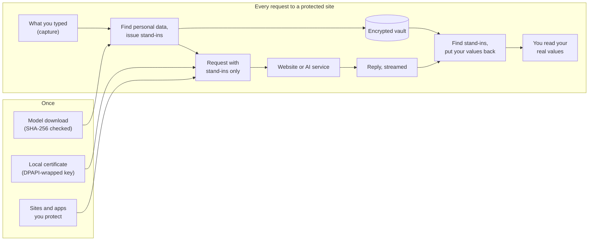

If the app dies, a watchdog gives Windows its previous proxy settings back. Detection, the proxy,
capture and highlight, the inventory with monitoring and cloud sources, the API, the app's status
and tray, and crash safety are described in [docs/how-it-works.md](docs/how-it-works.md); setting up
each cloud provider is in [docs/sources.md](docs/sources.md).

## Accuracy and speed

From the benchmark in [`eval/`](eval/README.md): the regex pass plus the model, on the CPU of an AMD
Ryzen 5 9600X.

| Corpus | Overlap F1 | Personal-data characters leaked | Docs/s (batches of 32) |
|---|---:|---:|---:|
| Hand-made NL/EN/DE chatbot prompts | 0.945 | 5.4% | 188 |
| gretel_en (synthetic English) | 0.889 | 3.5% | 68 |
| OpenPII (in-distribution for the model) | 0.866 | 2.9% | 50 |
| Finance, multilingual (long documents) | 0.690 | 23.6% | 12.7 |

The regex pass alone handles 190,000 to 600,000 docs/s. The benchmark README lists the methods, the
failure modes and how these numbers compare with published ones.

## Development

You need [rustup](https://rustup.rs) (the toolchain pinned in `rust-toolchain.toml` installs on
first use) and Node.js (only for the git hooks). The first build downloads the Windows App SDK
runtime and ONNX Runtime, and places their DLLs next to the executables, where the app needs them.

```sh
npm install                              # husky hooks and commitlint
cargo build --release --workspace        # target\release\piikey.exe and piikey-cli.exe
```

| Check | Command |
|---|---|
| Format | `cargo fmt-check` |
| Lint (clippy pedantic, `-D warnings`) | `cargo lint` |
| Tests | `cargo test --all-targets` |
| API reference | `cargo api-docs` (writes `docs/api/openapi.json` and `docs/api/README.md`; `--check-prose` flags stale hand-written notes in `docs/api/prose.toml`, `--accept <op>` re-stamps them) |
| Detection benchmark | `cargo run --release --example pii_eval` |
| Release zip, installer and MSIX | `./packaging/windows/package.ps1 -Version 0.1.0` |

The pre-commit hook runs the format check, lint and `cargo api-docs`; the pre-push hook runs the
tests; CI runs all three on Windows. Tests need no detection model; the model tests are `#[ignore]`.
Packaging needs [cargo-about](https://github.com/EmbarkStudios/cargo-about)
(`cargo install cargo-about --locked --features cli`) and [Inno Setup 6](https://jrsoftware.org/isinfo.php);
the MSIX step needs the Windows SDK, and `-SkipMsix` leaves it out.

Debug builds read `PIIKEY_THEME` (`light` or `dark`), `PIIKEY_NO_TRAY` and `PIIKEY_FAKE_CLOUD=1`
(a made-up cloud account), which the screenshots in `docs/assets/screenshots` are taken with.

Releases are automated: commits follow [Conventional Commits](https://www.conventionalcommits.org),
release-plz keeps a release PR open, and merging it tags `vX.Y.Z`, publishes the GitHub Release and
builds the zip, installer and MSIX. Never edit versions, `CHANGELOG.md` or tags by hand.

```
src/           library: detection, stand-ins, vault, engine, formats, inventory, cloud sources, API, CLI
app/           piikey.exe: the proxy, capture, highlight and the WinUI 3 window
eval/          detection benchmark corpora and results
docs/          how it works, cloud setup, the API reference, screenshots
packaging/     zip, installer and MSIX scripts
assets/brand/  the logo kit and the scripts that build icons and images from it
```

## Contributing

Issues and pull requests are welcome. Start with [CONTRIBUTING.md](CONTRIBUTING.md) and the
[Code of Conduct](CODE_OF_CONDUCT.md). Agents, read [AGENTS.md](AGENTS.md).

## Security and privacy

- Everything runs locally. piikey's one network call of its own is the model download from Hugging
  Face, checked with SHA-256. A connected cloud account is read through the provider's API,
  read-only; files are read into memory and dropped.
- Your values are kept in one place, the encrypted vault, apart from what you export. The Vault
  page's list of swaps keeps stand-ins, sites and times; the inventory keeps paths, counts per type
  and a fingerprint of each file, never values. What was found and Find on record keep values in
  memory only while they are on show.
- Masking and the highlight read the focused field only, never a password field, and the highlight
  stores nothing.
- The HTTP API is off by default; when on, it listens on loopback only, needs a token and refuses
  browser origins. The pipe accepts local clients only.
- The certificate that reads protected HTTPS traffic is created on your PC for your Windows user,
  its key wrapped with DPAPI; the uninstaller removes it.

To report a vulnerability privately, see [SECURITY.md](SECURITY.md).

## Acknowledgements

- [bardsai/eu-pii-anonimization-multilang-v2](https://huggingface.co/bardsai/eu-pii-anonimization-multilang-v2), the detection model
- [ONNX Runtime](https://onnxruntime.ai), through [`ort`](https://github.com/pykeio/ort)
- [windows-rs](https://github.com/microsoft/windows-rs)
- [hudsucker](https://github.com/omjadas/hudsucker)

[NOTICE.md](NOTICE.md) lists the third-party components (the detection model, ONNX Runtime,
DirectML and the Windows App SDK runtime). Every release includes `THIRD_PARTY_LICENSES.html` for
the Rust crates.

**Trademarks.** Microsoft 365, SharePoint, OneDrive, Google Drive, Dropbox and Box are trademarks of
their owners. piikey uses their names and logos only to identify the integrations, and is
independent of these companies (Box, Inc. and its affiliates included) and not endorsed or sponsored
by them. Google Drive is a trademark of Google Inc. Use of this trademark is subject to
[Google Permissions](https://www.google.com/permissions/index.html).

## License

[MIT](LICENSE) © 2026 TBLgGamin.
