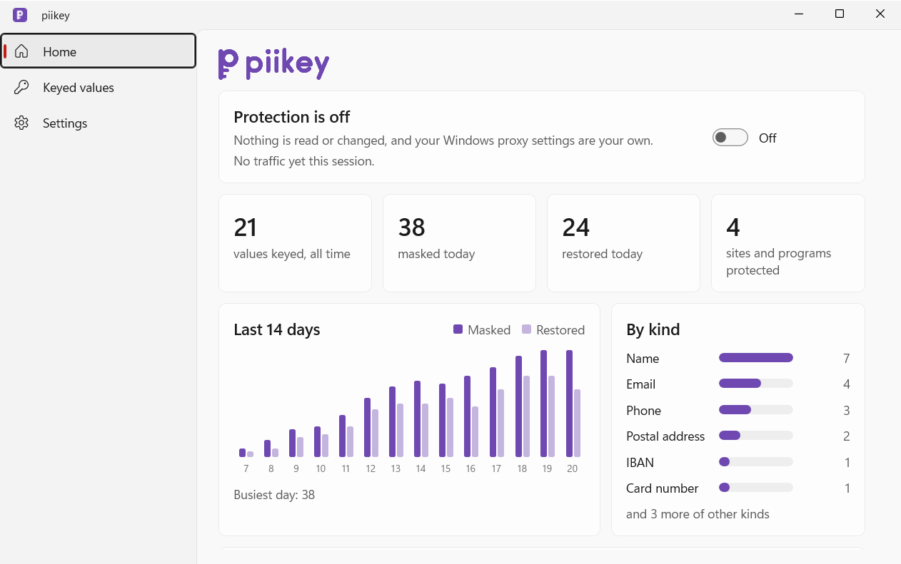
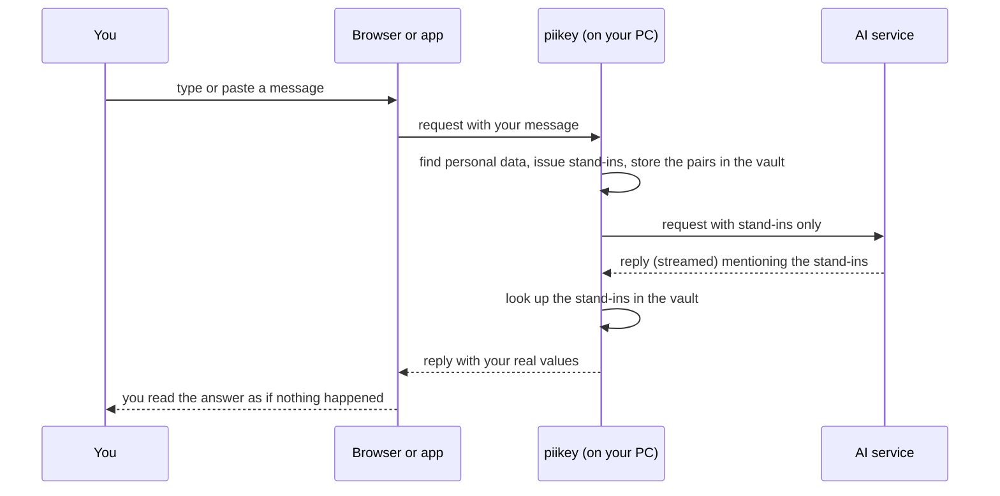
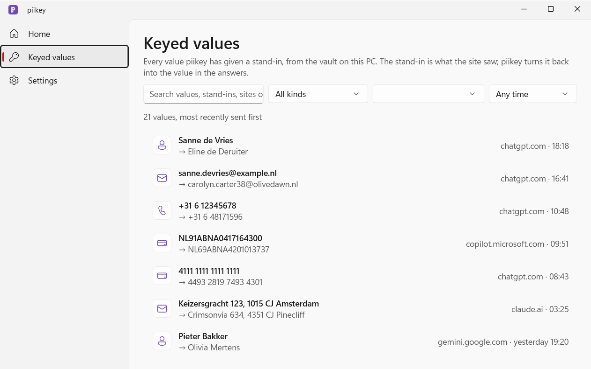

<div align="center">

<picture>
  <source media="(prefers-color-scheme: dark)" srcset="assets/brand/piikey-logo-kit/horizontal/piikey-horizontal-mono-d6c9f9.svg">
  
</picture>

<h3>Your personal data stays on your PC. AI gets believable stand-ins.</h3>

[](https://github.com/TBLgGamin/piikey/actions/workflows/ci.yml)
[](https://github.com/TBLgGamin/piikey/releases/latest)
[](https://github.com/TBLgGamin/piikey/releases)
[](LICENSE)
[](#install)
[](rust-toolchain.toml)
[](Cargo.toml)
[](https://scorecard.dev/viewer/?uri=github.com/TBLgGamin/piikey)
[](https://www.conventionalcommits.org)

[](https://github.com/TBLgGamin/piikey/releases/latest)

[Features](#features) · [Install](#install) · [How it works](#how-it-works) · [CLI](#command-line) · [Build](#build-from-source) · [Contributing](#contributing)

</div>

<br>

<picture>
  <source media="(prefers-color-scheme: dark)" srcset="docs/assets/screenshots/home-dark.png">
  
</picture>

## What it is

piikey sits between you and the AI chatbots you use. Before a message leaves your PC, it finds the
names, emails, phone numbers, IBANs, card numbers, addresses and other personal data in it and
swaps each one for a believable stand-in of the same shape. When the answer comes back, piikey puts
your real values back in. Detection, the stand-ins and the vault that remembers them all stay on
your machine.

## See it work

| You type | The AI receives |
|---|---|
| Hi, I'm Sanne de Vries (sanne.devries@example.nl, +31 6 12345678). Please refund €250 to NL91ABNA0417164300: my card 4111 1111 1111 1111 was charged twice. I live at Keizersgracht 123, 1015 CJ Amsterdam. | Hi, I'm Eline de Deruiter (carolyn.carter38@olivedawn.nl, +31 6 48171596). Please refund €250 to NL69ABNA4201013737: my card 4493 2819 7493 4301 was charged twice. I live at Crimsonvia 634, 4351 CJ Pinecliff. |

That is real `piikey-cli anonymize` output. The stand-ins keep their shape: the IBAN still passes
mod-97, the card still passes Luhn, the phone number is still Dutch. Running `piikey-cli
deanonymize` on the right column gives back the left column character for character, and the app
does the same to the chatbot's reply as it streams in.

## Features

- **Pattern detection with validation.** Emails, phone numbers, IBANs (mod-97), credit cards
  (Luhn), IPv4/IPv6, MAC addresses, US SSNs, Dutch BSNs (11-proof), URL credentials, API keys and
  JWTs.
- **An on-device model for the rest.** A multilingual token classifier (24 EU languages) finds
  names, addresses, organizations, IDs, dates of birth, account numbers and the GDPR special
  categories. It runs on the CPU, and the GPU joins in through DirectML for large batches.
- **Believable, format-preserving stand-ins.** Each value gets a replacement of the same kind and
  shape, so the AI's answer still makes sense. The pattern kinds carry an invisible keyed watermark.
- **An encrypted vault.** The original↔stand-in pairs are stored with XChaCha20-Poly1305 under a
  key that Windows DPAPI protects for your user account.
- **A restore that forgives.** Streamed replies, a stand-in the AI wrote with a typo, and a first or
  last name on its own all come back as your original.
- **Only what you type or paste.** The app reads the focused text field and the clipboard for the
  sites and programs you protect, and replaces exactly those values. Scripts, IDs and telemetry are
  left alone, password fields are never read, and you need no browser extension.
- **Documents too.** DOCX, XLSX, PPTX and ODF (rewritten in place), PDF, images (Windows OCR), and
  .eml/.msg.
- **Nothing leaves your PC.** No cloud service or account. The project's own code is 100% safe Rust
  (`unsafe` is forbidden).

## How it works



piikey sets itself as the Windows proxy while the app runs. It only opens the traffic of sites and
programs you protect; everything else passes through untouched. If the app crashes, a watchdog
gives Windows its previous proxy settings back. Detection, the proxy, the app's pages and the files
piikey keeps are described in [docs/how-it-works.md](docs/how-it-works.md).

## Screenshots

<table>
  <tr>
    <td width="50%">
      <picture>
        <source media="(prefers-color-scheme: dark)" srcset="docs/assets/screenshots/keyed-dark.png">
        
      </picture>
    </td>
    <td width="50%">
      <picture>
        <source media="(prefers-color-scheme: dark)" srcset="docs/assets/screenshots/settings-dark.png">
        
      </picture>
    </td>
  </tr>
  <tr>
    <td><b>Keyed values</b>: every value in the vault next to its stand-in, most recently sent first, with search and filters by kind, site and time.</td>
    <td><b>Settings</b>: the sites and programs to protect, a switch for every kind of personal data, and the local certificate.</td>
  </tr>
</table>

## Install

Download from the [latest release](https://github.com/TBLgGamin/piikey/releases/latest):

- **Installer** (`piikey-<version>-setup-x64.exe`): installs for your user only, without admin
  rights, to `%LOCALAPPDATA%\Programs\piikey`, and adds a Start-menu entry and an uninstaller.
- **Portable** (`piikey-<version>-windows-x64.zip`): unzip it anywhere and run `piikey\piikey.exe`.

On first start, piikey downloads its detection model (about 343 MB, checked with SHA-256) to
`%LOCALAPPDATA%\piikey\models`. Turn protection on, pick your sites, and accept the certificate
prompt once.

The builds are not code-signed yet, so Windows SmartScreen asks once: choose **More info**, then
**Run anyway**.

**Verify your download.** Compare the hash with `SHA256SUMS.txt` from the same release:

```powershell
Get-FileHash .\piikey-0.1.0-setup-x64.exe -Algorithm SHA256
```

Every release asset carries a build provenance attestation, which proves it was built from this
repository by GitHub Actions:

```sh
gh attestation verify piikey-0.1.0-setup-x64.exe --repo TBLgGamin/piikey
```

**Uninstall** (Settings > Apps, or the Start menu). The uninstaller stops piikey, gives Windows its
proxy settings back, and removes the local certificate. It then asks before it deletes your data
in `%LOCALAPPDATA%\piikey`. Keep that data if you still want earlier stand-ins to come back as
your values.

## Accuracy and speed

From the benchmark in [`eval/`](eval/README.md): regex pass plus model, on the CPU of an AMD Ryzen 5
9600X.

| Corpus | Overlap F1 | PII characters leaked | Docs/s (batches of 32) |
|---|---:|---:|---:|
| Hand-made NL/EN/DE chatbot prompts | 0.945 | 5.4% | 188 |
| gretel_en (synthetic English) | 0.889 | 3.5% | 68 |
| OpenPII (in-distribution for the model) | 0.866 | 2.9% | 50 |
| Finance, multilingual (long documents) | 0.690 | 23.6% | 12.7 |

The regex pass alone handles 190,000 to 600,000 docs/s. The benchmark README lists the methods,
the failure modes and how these numbers compare with published ones.

## Command line

`piikey-cli.exe` ships next to the app:

```sh
piikey-cli anonymize   [--vault PATH] [--out DIR] [PATH...]   # stdin -> stdout without paths
piikey-cli deanonymize [--vault PATH] [--tolerant] [--out DIR] [PATH...]
piikey-cli serve       [--vault PATH] [--pipe NAME]           # default \\.\pipe\piikey
piikey-cli --version
```

With paths, `--out DIR` is required and directories are walked recursively. `--tolerant` also
restores stand-ins that came back with a typo, and first or last names that came back alone (text
only, not zip documents). The default vault is `%LOCALAPPDATA%\piikey\vault.pkv`, which only the
Windows user who created it can read. The CLI uses the detection model once the app has downloaded
it, and masks patterns only until then.

## Build from source

You need [rustup](https://rustup.rs) (the toolchain pinned in `rust-toolchain.toml` installs on
first use) and Node.js (only for the git hooks).

```sh
npm install                              # husky hooks and commitlint
cargo build --release --workspace        # target\release\piikey.exe and piikey-cli.exe
```

The first build downloads the Windows App SDK runtime and ONNX Runtime, so it needs network
access. The runtime DLLs and resource folders are placed next to the executables, and the app
needs them there. To make the release zip and installer yourself, you need
[cargo-about](https://github.com/EmbarkStudios/cargo-about) (`cargo install cargo-about --locked --features cli`)
and [Inno Setup 6](https://jrsoftware.org/isinfo.php):

```powershell
./packaging/windows/package.ps1 -Version 0.1.0   # dist\piikey-0.1.0-windows-x64.zip, -setup-x64.exe, SHA256SUMS.txt
```

Checks: `cargo fmt-check`, `cargo lint`, and `cargo test --all-targets`.

## Privacy and security

- Everything runs locally. piikey makes one network call of its own: the model download from
  Hugging Face, which is checked with SHA-256.
- Your values exist in one place only, the encrypted vault in `%LOCALAPPDATA%\piikey`. The activity
  feed and the statistics keep stand-ins, sites and counts.
- Password fields are never read.
- The certificate piikey uses to read protected HTTPS traffic is created on your PC for your
  Windows user. Its key is wrapped with DPAPI, and the uninstaller removes it.

To report a vulnerability privately, see [SECURITY.md](SECURITY.md).

## Contributing

Issues and pull requests are welcome. Start with [CONTRIBUTING.md](CONTRIBUTING.md) and the
[Code of Conduct](CODE_OF_CONDUCT.md). Agents, read [AGENTS.md](AGENTS.md). Commits follow
[Conventional Commits](https://www.conventionalcommits.org). Versions, the changelog and releases
are automated by release-plz, so never edit them by hand.

## License

[MIT](LICENSE) © 2026 TBLgGamin. [NOTICE.md](NOTICE.md) lists the third-party components (the
detection model, ONNX Runtime, DirectML and the Windows App SDK runtime). Every release includes
`THIRD_PARTY_LICENSES.html` for the Rust crates.

**Acknowledgements:**
- [bardsai/eu-pii-anonimization-multilang-v2](https://huggingface.co/bardsai/eu-pii-anonimization-multilang-v2), the detection model
- [ONNX Runtime](https://onnxruntime.ai), through [`ort`](https://github.com/pykeio/ort)
- [windows-rs](https://github.com/microsoft/windows-rs)
- [hudsucker](https://github.com/omjadas/hudsucker)
