<div align="center">

<picture>
  <source media="(prefers-color-scheme: dark)" srcset="assets/brand/piikey-logo-kit/horizontal/piikey-horizontal-mono-d6c9f9.svg">
  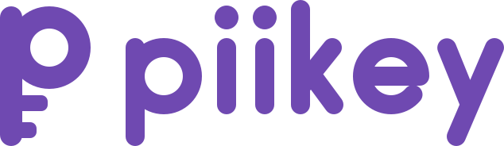
</picture>

<h3>Find, flag and mask your personal data, everywhere on your PC. Local, fast, always in the background.</h3>

[](https://github.com/TBLgGamin/piikey/releases/latest)
[](https://github.com/TBLgGamin/piikey/releases)
[](https://github.com/TBLgGamin/piikey/actions/workflows/ci.yml)
[](LICENSE)
[](#install)

<br>

<picture>
  <source media="(prefers-color-scheme: dark)" srcset="docs/assets/hero-dark.png">
  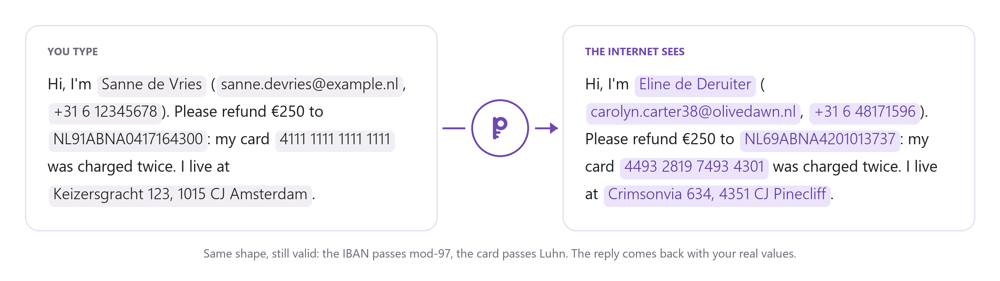
</picture>

<br><br>

[](https://github.com/TBLgGamin/piikey/releases/latest)

[Features](#features) · [Install](#install) · [How it works](#how-it-works) · [API](#api) · [CLI](#command-line) · [Build](#build-from-source) · [Contributing](#contributing)

</div>

## What it is

piikey is a personal-data manager that runs in the background on your PC. It finds names, emails,
phone numbers, IBANs, card numbers, addresses and other personal data and puts you in charge of it,
in four ways:

- **Mask what you send.** For the sites and apps you choose (chatbots, webmail, forms, anything
  that goes through the Windows proxy), piikey swaps each value for a believable stand-in of the same
  shape before the message leaves your PC, and puts your real values back into the answer.
- **Flag what you type.** The field you are typing in gets a purple outline when it holds personal
  data, in any app, so you see it before you send it.
- **Map what you store.** Scan your folders, or any file or folder from Explorer's right-click menu,
  and see which of them hold personal data, in a WinDirStat-style dashboard. Open a file or a
  folder to read the values themselves, with where each one sits (line, page or cell) and a
  button that opens the file at that place. Nothing is scanned until you ask, and a rescan reads
  only what changed. The inventory keeps only what lies in your locations. Switch on Monitor for a location and piikey looks at a file again a moment after it changes.
- **Manage what is kept.** Search the vault, forget values and export it. The CLI and the API
  also find every file that mentions a person, and gate scripts and CI on personal data.

Detection, the stand-ins and the vault that remembers them all stay on your machine.

In the example above, the masked message is real `piikey-cli anonymize` output. The reply is turned
back into your values by `piikey-cli deanonymize --tolerant`: the full names, the lone first name
"Kevin" and the phone number all come back as yours.

<picture>
  <source media="(prefers-color-scheme: dark)" srcset="docs/assets/screenshots/overview-dark.png">
  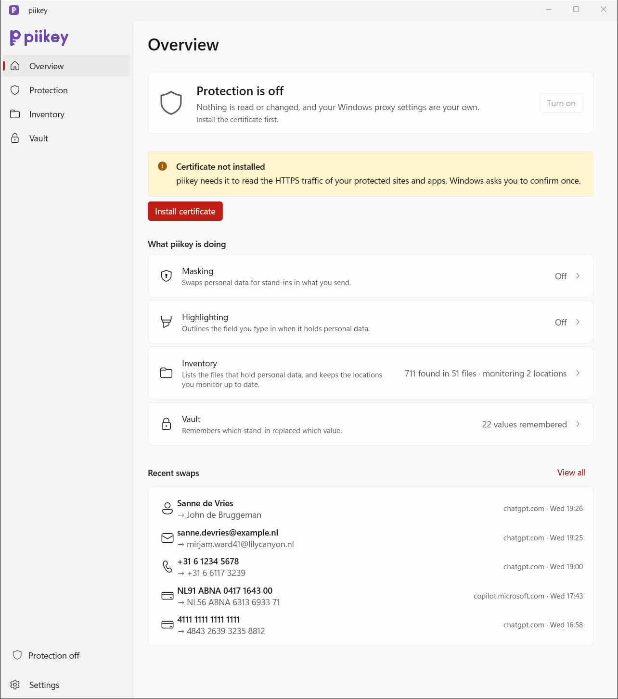
</picture>

## Features

<table>
  <tr>
    <td width="48"><picture><source media="(prefers-color-scheme: dark)" srcset="docs/assets/icons/dark/mask.svg"></picture></td>
    <td><b>Masking for sites and apps</b><br>Replaces what you type or paste into the sites and apps you protect with format-preserving stand-ins, restores them in the (streamed) answer, and forgives typos and lone first names.</td>
  </tr>
  <tr>
    <td><picture><source media="(prefers-color-scheme: dark)" srcset="docs/assets/icons/dark/highlight.svg"></picture></td>
    <td><b>Live highlight</b><br>Outlines the field you are typing in when it holds personal data, in any app, always or when you press Ctrl+Alt+P. Nothing is stored.</td>
  </tr>
  <tr>
    <td><picture><source media="(prefers-color-scheme: dark)" srcset="docs/assets/icons/dark/explorer.svg"></picture></td>
    <td><b>"Scan for personal data" in Explorer</b><br>Right-click a file or folder (under Show more options on Windows 11) to see what personal data it holds. The result opens in piikey, with a progress bar for each file while it is read.</td>
  </tr>
  <tr>
    <td><picture><source media="(prefers-color-scheme: dark)" srcset="docs/assets/icons/dark/inventory.svg"></picture></td>
    <td><b>Inventory</b><br>Scan your folders and see where personal data is stored, in a dashboard like a disk-usage viewer: a tree of your real folders from the drives down (<code>C:</code>, Users, ...) in Explorer's order with a bar by type on each row, a legend of the types found, a treemap with a tile for every file, and details with actions per file: open, show in Explorer, show what was found, make a masked copy. <b>Show what was found</b> lists every value with its type, the text around it and where it is (line, page, sheet and cell), searchable and filterable by type and file, and <b>Open at this place</b> jumps to it in the file. The values are read when you ask and never stored. Add folders and files with Browse or by dropping them on the page, and write a CSV with Export report. It scans when you ask, and skips files that did not change. The inventory keeps only what lies in your locations: a file or folder scanned from outside them (Explorer, a drop, the box) still shows its result and what was found, but is forgotten from the inventory right after. Switch on <b>Monitor</b> for a location and its files are looked at again a moment after they change; each location says what it holds and what monitoring is doing.</td>
  </tr>
  <tr>
    <td><picture><source media="(prefers-color-scheme: dark)" srcset="docs/assets/icons/dark/subject.svg"></picture></td>
    <td><b>Subject search</b><br>Finds every file that mentions a person's name, email or phone number, for access requests (DSAR). It is in the CLI (<code>piikey-cli subject</code>) and the API (<code>subject_search</code>), not in the app window.</td>
  </tr>
  <tr>
    <td><picture><source media="(prefers-color-scheme: dark)" srcset="docs/assets/icons/dark/vault.svg"></picture></td>
    <td><b>An encrypted vault you control</b><br>Search and filter it, export it to CSV, forget the values you tick. Forgetting rewrites the file, so the value is gone from disk (the API and the CLI can also wipe it). Records are sealed with XChaCha20-Poly1305 under a key that Windows DPAPI protects.</td>
  </tr>
  <tr>
    <td><picture><source media="(prefers-color-scheme: dark)" srcset="docs/assets/icons/dark/api.svg"></picture></td>
    <td><b>JSON API</b><br>One API on a named pipe and, if you switch it on, on a token-protected HTTP port at 127.0.0.1.</td>
  </tr>
  <tr>
    <td><picture><source media="(prefers-color-scheme: dark)" srcset="docs/assets/icons/dark/terminal.svg"></picture></td>
    <td><b>CLI and CI gate</b><br>Every API operation is a <code>piikey-cli</code> subcommand, and <code>scan --fail-on</code> fails a commit or a build that contains personal data.</td>
  </tr>
  <tr>
    <td><picture><source media="(prefers-color-scheme: dark)" srcset="docs/assets/icons/dark/documents.svg"></picture></td>
    <td><b>Documents, PDFs, images and mail</b><br>DOCX, XLSX, PPTX and ODF (rewritten in place), PDF, images (Windows OCR), and .eml/.msg.</td>
  </tr>
  <tr>
    <td><picture><source media="(prefers-color-scheme: dark)" srcset="docs/assets/icons/dark/model.svg"></picture></td>
    <td><b>An on-device model</b><br>Validated patterns (IBAN mod-97, Luhn, Dutch BSN, JWTs and more) plus a multilingual token classifier for names, addresses, IDs and the GDPR special categories in 24 EU languages. It runs on the CPU, and the GPU joins in through DirectML for large batches.</td>
  </tr>
  <tr>
    <td><picture><source media="(prefers-color-scheme: dark)" srcset="docs/assets/icons/dark/local.svg"></picture></td>
    <td><b>Nothing leaves your PC</b><br>No cloud service or account, no browser extension. The project's own code is 100% safe Rust (<code>unsafe</code> is forbidden).</td>
  </tr>
</table>

## How it works

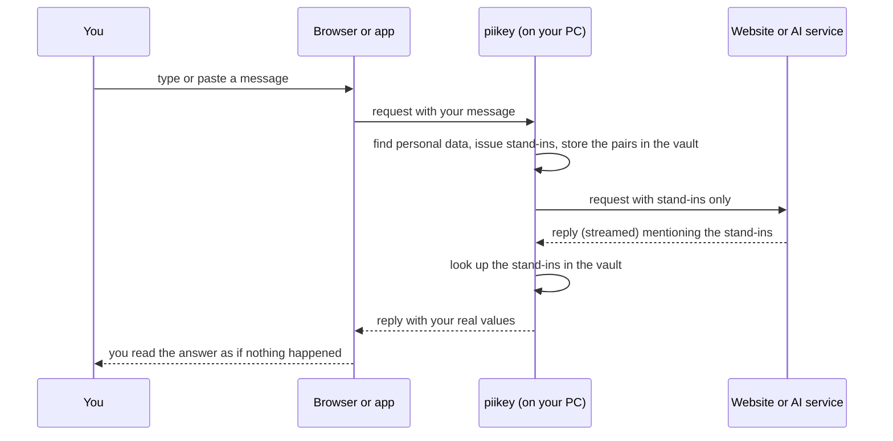

Background workers, and how the CLI, scripts and Explorer reach them:

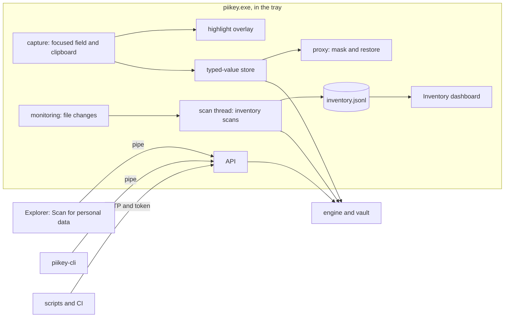

piikey sets itself as the Windows proxy while protection is on. It only opens the traffic of sites
and apps you protect; everything else passes through untouched. If the app crashes, a watchdog
gives Windows its previous proxy settings back. The highlight, the inventory with its monitoring and the API
run in the same app and need no proxy. Detection, the proxy, the app's pages and the files piikey
keeps are described in [docs/how-it-works.md](docs/how-it-works.md).

## The app

`piikey.exe` is one window with five pages, and a tray icon.

- **Overview** says in one sentence whether protection is on, and has the one Turn on / Turn off
  button. When something needs you, such as a certificate that is not installed, one message shows
  with its fix button. Below it, four rows say what piikey is doing (Masking, Highlighting,
  Inventory, Vault; each opens its page), then the five most recent swaps, each
  value next to its stand-in.
- **Protection** holds the highlighting mode (off, always, or when you press Ctrl+Alt+P), the
  protected sites and the protected apps. The certificate is installed from Overview.
- **Inventory** is where you scan. It lists your locations (none until you add one) with what each
  holds, a Monitor switch (on: piikey keeps an eye on the location and looks at a file again a
  moment after it changes; it says when it is scanning, when it last saw a change, or why it cannot
  monitor) and a Remove button, which also breaks off a scan of it. The Scan button looks through
  them; the box below scans one more folder or file, with Browse buttons for the Windows pickers,
  and you can drop files and folders from Explorer onto the page.
  - A scan that you start from the page, the box, a drop or Explorer ends in a **result dialog**:
    while it runs, a bar for the whole scan and one for each file being read; afterwards how much
    was found, by type, with Show what was found and, when the scanned path lies in a location or holds one, Show in Inventory. Closing it while it runs
    stops the scan.
  - The **dashboard** is a tree of your real folders from the drives down (This PC, `C:`, Users,
    ...) in Explorer's order, with a bar by type on each row and a breadcrumb to go back up; the
    types found (pick one to show only that type); a treemap with a tile for every file; and the
    details of what you select. For a file the details offer Open, Show in Explorer, Show what was
    found and Make masked copy (next to the file; it never replaces one); for a folder, Show only
    this folder, Show in Explorer and Show what was found. Export report writes what is on show as
    a CSV file in Downloads.
  - **What was found** (from the dialog or the details) takes the page's place, with a way back.
    The inventory keeps counts, never values, so this reads the files again and lists every value
    whole, as the files are read, with its type, the text around it, its file and where it is
    (`line 12`, `page 3`, `Sheet1, cell B7`, `slide 4`). A search box matches the value, the type,
    the file and the text around it; chips filter by type, with their counts; for a folder a list
    narrows it to one file. **Open at this place** on each row opens the file at the value: VS
    Code, Notepad++ and Sublime Text go to the line, other apps that Windows can read select the
    value and outline it for two seconds, and the rest just open the file. The values stay in the
    window only while the view is open; nothing is stored.
- **Vault** lists every value next to its stand-in, newest first, with search and filters by type,
  site and time. Tick values (or Select all) and choose Forget to remove them, after a
  confirmation; Export writes them to a CSV file in Downloads, which holds the values themselves,
  so keep it safe.
- **Settings** is one scrolling page: General (Start piikey when I sign in, Scan for personal data
  in Explorer, which adds the right-click entry, and Keep piikey running in the tray when I close
  the window), Types of personal data, Developer access (the local HTTP API and its token),
  Privacy & data (the data folder, with Open folder) and About. A row for the detection model appears only when it
  was skipped or failed.

The tray icon shows the same status as Overview (the key in grey while protection is off, the app
icon while it is on, with an amber dot when it needs you). Its menu has Open piikey, Turn protection
on or off, and Quit piikey. With "Keep piikey running in the tray when I close the window" on (the
default), closing the window leaves protection, highlighting, monitoring and the API working; off,
closing it quits piikey. Starting piikey again while it runs brings the window forward instead of
starting a second copy (`piikey-cli open` does the same). With "Start piikey when I sign in" on,
piikey starts in the tray at sign-in without a window.

<table>
  <tr>
    <td width="50%">
      <picture>
        <source media="(prefers-color-scheme: dark)" srcset="docs/assets/screenshots/protection-dark.png">
        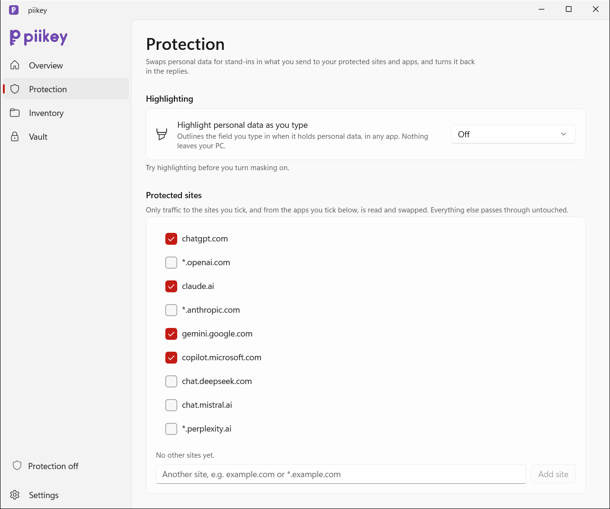
      </picture>
    </td>
    <td width="50%">
      <picture>
        <source media="(prefers-color-scheme: dark)" srcset="docs/assets/screenshots/inventory-dark.png">
        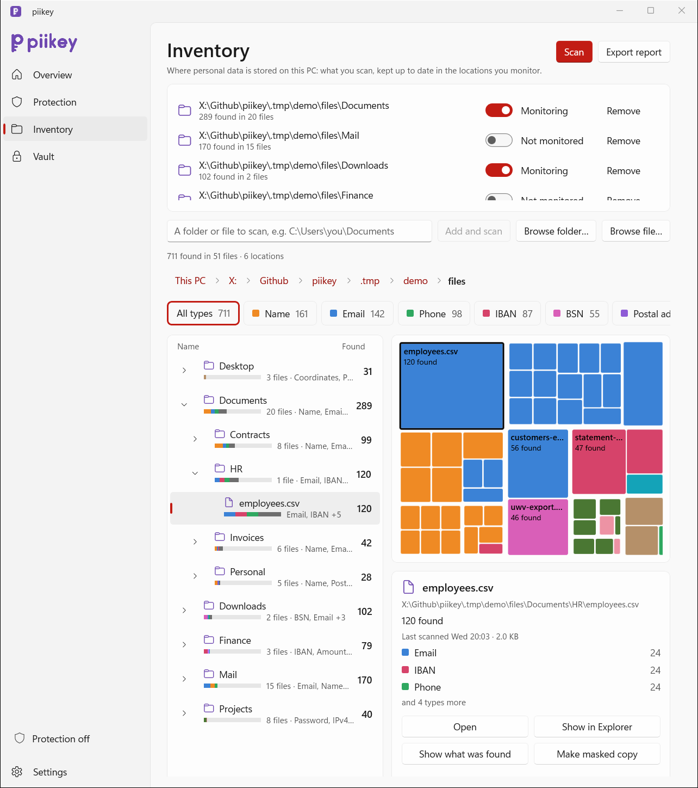
      </picture>
    </td>
  </tr>
  <tr>
    <td><b>Protection</b>: what piikey masks and highlights. The highlighting mode and the sites and apps you protect.</td>
    <td><b>Inventory</b>: where personal data is stored on this PC, as a tree of your real folders from the drive down, a legend of types and a treemap with a tile for every file, from what you scanned.</td>
  </tr>
  <tr>
    <td width="50%">
      <picture>
        <source media="(prefers-color-scheme: dark)" srcset="docs/assets/screenshots/vault-dark.png">
        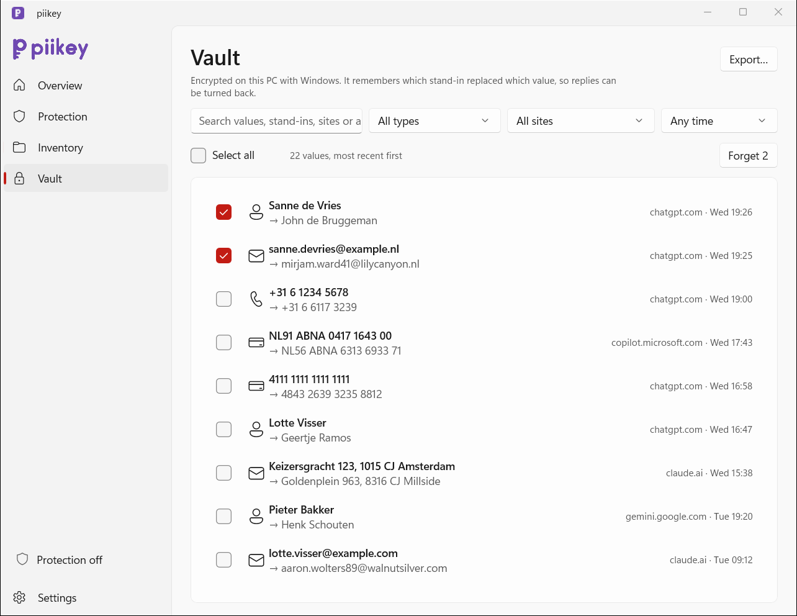
      </picture>
    </td>
    <td width="50%">
      <picture>
        <source media="(prefers-color-scheme: dark)" srcset="docs/assets/screenshots/settings-dark.png">
        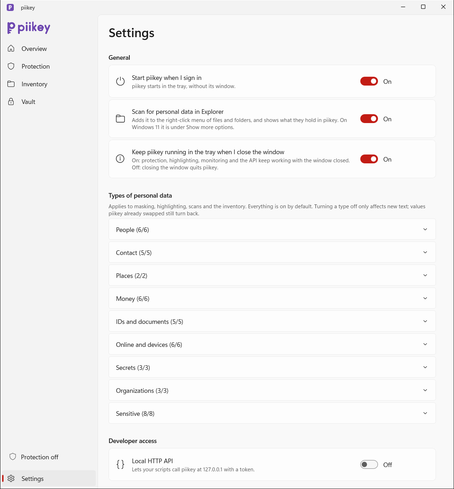
      </picture>
    </td>
  </tr>
  <tr>
    <td><b>Vault</b>: every value next to its stand-in, most recently swapped first, with search and filters by type, site and time, and Forget for the ticked ones (its button sits above the list, next to Select all).</td>
    <td><b>Settings</b>: start at sign-in, the Explorer menu, whether closing the window keeps piikey in the tray, the types of personal data piikey looks for, the local HTTP API, and where your data is kept.</td>
  </tr>
  <tr>
    <td width="50%">
      <picture>
        <source media="(prefers-color-scheme: dark)" srcset="docs/assets/screenshots/scanning-dark.png">
        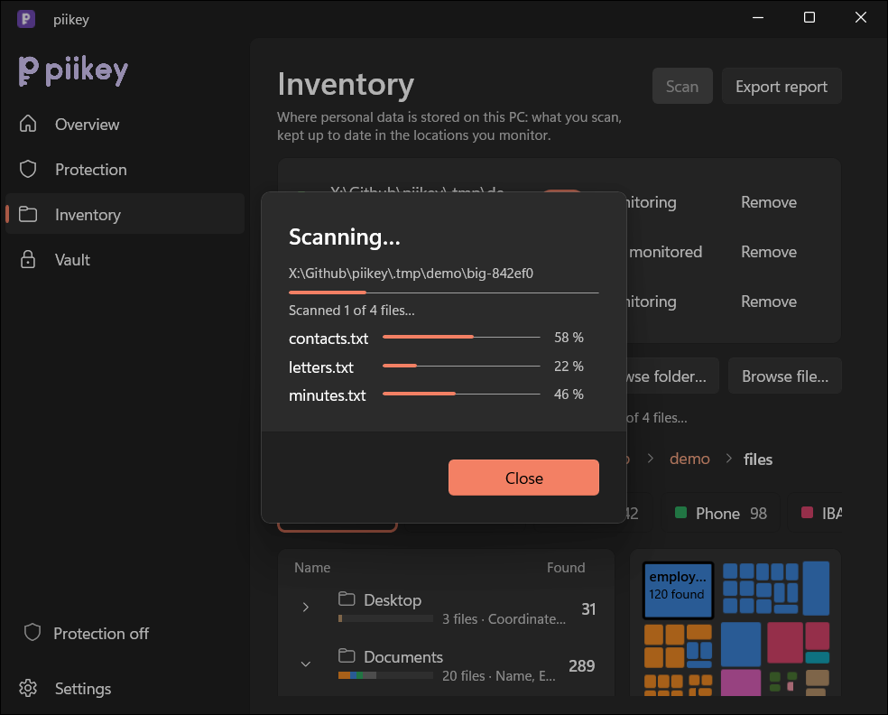
      </picture>
    </td>
    <td width="50%">
      <picture>
        <source media="(prefers-color-scheme: dark)" srcset="docs/assets/screenshots/result-dark.png">
        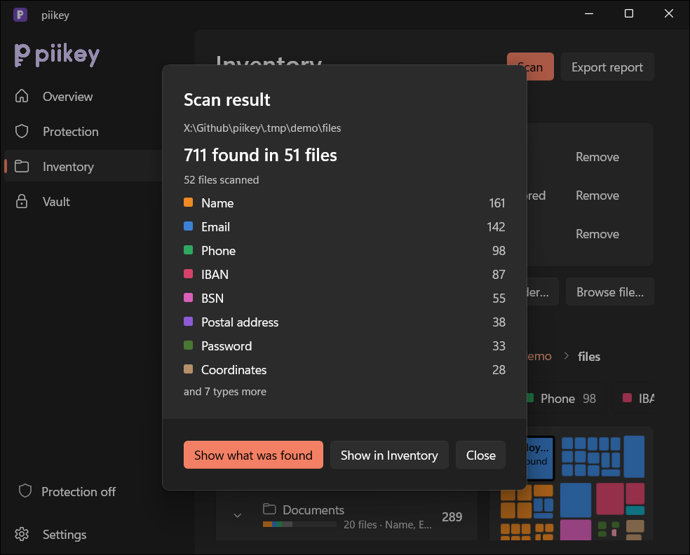
      </picture>
    </td>
  </tr>
  <tr>
    <td><b>A scan</b> from the page, a drop or Explorer: a bar for each file being read. Close stops it.</td>
    <td><b>Its result</b>: what was found, by type, and the way to the values.</td>
  </tr>
  <tr>
    <td colspan="2" align="center">
      <picture>
        <source media="(prefers-color-scheme: dark)" srcset="docs/assets/screenshots/findings-dark.png">
        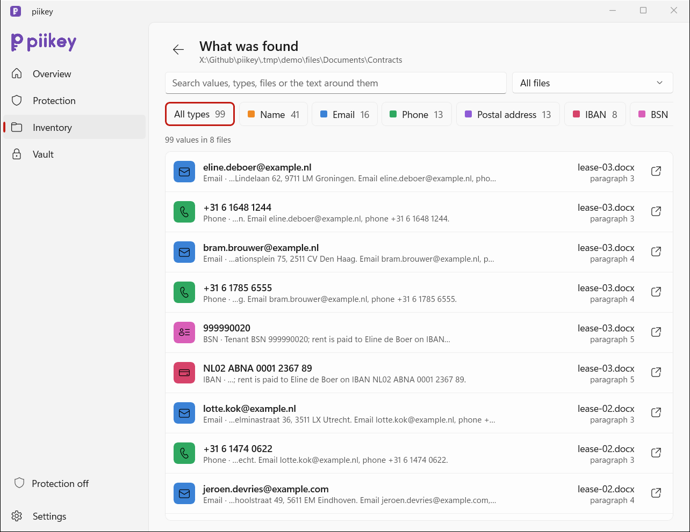
      </picture>
    </td>
  </tr>
  <tr>
    <td colspan="2"><b>What was found</b>: every value of a file or folder, with search, type and file filters, where it is (line, page or cell) and a button that opens the file at that place. Nothing of it is stored.</td>
  </tr>
</table>

## Install

Download from the [latest release](https://github.com/TBLgGamin/piikey/releases/latest):

- **Installer** (`piikey-<version>-setup-x64.exe`): installs for your user only, without admin
  rights, to `%LOCALAPPDATA%\Programs\piikey`, and adds a Start-menu entry and an uninstaller.
- **Portable** (`piikey-<version>-windows-x64.zip`): unzip it anywhere and run `piikey\piikey.exe`.

On first start, piikey downloads its detection model (about 343 MB, checked with SHA-256) to
`%LOCALAPPDATA%\piikey\models`. On Overview install the certificate (Windows asks once), tick your
sites on the Protection page, then turn protection on at Overview.

The builds are not code-signed yet, so Windows SmartScreen asks once: choose **More info**, then
**Run anyway**.

**Verify your download.** Compare the hash with `SHA256SUMS.txt` from the same release:

```powershell
Get-FileHash .\piikey-0.1.0-setup-x64.exe -Algorithm SHA256
```

Every release asset carries a build provenance attestation, which proves it was built from this
repository by GitHub Actions:

```sh
gh attestation verify piikey-0.1.0-setup-x64.exe --repo TBLgGamin/piikey
```

**Uninstall** (Settings > Apps, or the Start menu). The uninstaller stops piikey, gives Windows its
proxy settings back, removes the start-at-sign-in entry and the local certificate. It then asks
before it deletes your data in `%LOCALAPPDATA%\piikey`. Keep that data if you still want earlier
stand-ins to come back as your values.

## Accuracy and speed

From the benchmark in [`eval/`](eval/README.md): regex pass plus model, on the CPU of an AMD Ryzen 5
9600X.

| Corpus | Overlap F1 | Personal-data characters leaked | Docs/s (batches of 32) |
|---|---:|---:|---:|
| Hand-made NL/EN/DE chatbot prompts | 0.945 | 5.4% | 188 |
| gretel_en (synthetic English) | 0.889 | 3.5% | 68 |
| OpenPII (in-distribution for the model) | 0.866 | 2.9% | 50 |
| Finance, multilingual (long documents) | 0.690 | 23.6% | 12.7 |

The regex pass alone handles 190,000 to 600,000 docs/s. The benchmark README lists the methods,
the failure modes and how these numbers compare with published ones.

## API

Everything piikey does is one JSON API. The app serves it on a named pipe, and on an HTTP port at
127.0.0.1 if you switch that on in Settings > Developer access. `piikey-cli` is a client of the same
API, so each operation below is also a subcommand. Without the app, `piikey-cli` runs the same
operations in its own process (`--local`), except `protection`, `explorer_scan` and `show_window`,
which answer `app_required`.

| Operation (`op`) | Does | CLI |
|---|---|---|
| `scan_text` | Finds personal data in texts without changing the vault. Spans are UTF-8 byte offsets. | `scan` (stdin) |
| `anonymize`, `deanonymize` | Masks or restores texts. `deanonymize` takes `tolerant`. | `anonymize`, `deanonymize` (stdin) |
| `scan_files` | Scans files and folders, and records the result in the inventory unless `record` is false. | `scan PATH...` |
| `anonymize_files`, `deanonymize_files` | Rewrites files into `out`. | `anonymize --out DIR PATH...`, `deanonymize ...` |
| `subject_search` | Finds the files that mention the given `values` (no `paths`: the inventory folders). | `subject --value V` |
| `vault_list` | Lists the vault, newest first, filtered by `query` and `kind` (the type), paged by `limit` and `offset`. | `vault list` |
| `vault_forget` | Forgets the records whose value or stand-in is one of `values`. | `vault forget VALUE...` |
| `vault_export` | Writes the vault to a new file as JSON or CSV. | `vault export --out FILE` |
| `vault_wipe` | Deletes every record. Needs `"confirm": true`. | `vault wipe --yes` |
| `inventory_status` | The locations, which of them are monitored, file counts, hits and the scan in progress. | `inventory status` |
| `inventory_list`, `inventory_tree` | The files with personal data, or the tree's nodes under a path (the drives that hold them without one). | `inventory list`, `inventory tree` |
| `inventory_rescan`, `inventory_report` | Scans the inventory locations now and answers when the scan is over (the inventory scans only when asked); writes a JSON or CSV report. | `inventory rescan`, `inventory report` |
| `settings_get`, `settings_set` | Reads or changes the settings (the `guard.cfg` keys). | `settings get`, `settings set KEY=VALUE...` |
| `kinds` | The types of personal data (the `kind` field), their groups, and whether each is on. | `kinds` |
| `model_status`, `model_download` | The detection model's state; downloads it. | `model status`, `model download` |
| `api_token` | The HTTP token; `rotate` makes a new one. | `token [--rotate]` |
| `status` | Whether the app runs, protection, version, vault size, model and feature switches (including `monitoring`). | `status` |
| `protection` | Turns masking on or off. App only. | `protection on\|off` |
| `explorer_scan` | Scans paths into the inventory and shows the result in a dialog in the app, which opens if hidden. App only; answers when the scan is queued; the Explorer menu uses it. | none |
| `show_window` | Brings the app's window forward. App only; a second start of `piikey.exe` uses it. | `open` |

**Replies** share one envelope: `{"ok": true, "result": ...}`, or `{"ok": false, "error": {"code":
"...", "message": "..."}}`. The codes are `bad_request`, `app_required`, `not_found`, `busy`, `io`,
`vault`, `unsupported`, `model` and `internal`.

**Named pipe.** The pipe is `\\.\pipe\piikey-<USERNAME>`, where characters other than letters,
digits, `.`, `_` and `-` in the name become `_`. Only local clients can connect. A request is the
bytes `P`, `2`, `0`, `0`, a `u32` little-endian length, then the request JSON, for example
`{"op": "scan_text", "texts": ["mail jan@acme.nl"]}`. The reply is a status byte (0 ok, 1 error),
three zero bytes, a `u32` little-endian length and the envelope. Version 1 (binary) is no longer
accepted.

**HTTP.** Turn on "Local HTTP API" in Settings > Developer access (default port 7980, loopback only). Send
`POST /v1/<op>` with the request's fields as the JSON body (without `op`; `GET /v1/status` also
works) and a bearer token from `piikey-cli token`. Requests with an `Origin` header are refused, so
web pages cannot call it. Replies use the envelope, with the HTTP status 200, 400, 401, 403, 404,
405, 409, 413 or 500.

```sh
curl -H "Authorization: Bearer $(piikey-cli token)" \
     -d '{"texts":["mail jan@acme.nl"]}' http://127.0.0.1:7980/v1/scan_text
# {"ok":true,"result":{"results":[[{"start":5,"end":16,"kind":"email","value":"jan@acme.nl"}]]}}
```

```python
import json
import subprocess
import urllib.request

token = subprocess.check_output(["piikey-cli", "token"], text=True).strip()
request = urllib.request.Request(
    "http://127.0.0.1:7980/v1/scan_text",
    data=json.dumps({"texts": ["mail jan@acme.nl"]}).encode(),
    headers={"Authorization": f"Bearer {token}", "Content-Type": "application/json"},
)
with urllib.request.urlopen(request) as reply:
    print(json.load(reply)["result"]["results"])
```

## Command line

`piikey-cli.exe` ships next to the app and has one subcommand per API operation:

```
piikey-cli scan [--fail-on KINDS|any] [--no-record] [PATH...]        no PATH: stdin text
piikey-cli anonymize [--out DIR] [PATH...]                            no PATH: stdin -> stdout
piikey-cli deanonymize [--tolerant] [--out DIR] [PATH...]
piikey-cli subject --value V [--value V ...] [PATH...]
piikey-cli vault list [--query Q] [--kind KIND] [--limit N] [--offset N]
piikey-cli vault forget VALUE...
piikey-cli vault export --out FILE [--format json|csv]
piikey-cli vault wipe --yes
piikey-cli inventory status | list [--under PATH] [--limit N] [--offset N] | tree [--under PATH] | rescan | report --out FILE [--format json|csv]
piikey-cli settings get | settings set KEY=VALUE...      keys = guard.cfg keys; list keys repeat (site=a site=b)
piikey-cli kinds | model status | model download | token [--rotate] | status | protection on|off
piikey-cli open      brings the running app's window forward (needs the app)
piikey-cli serve [--http [--port N]] [--pipe NAME]
global: --json  --local  --vault PATH  -h/--help  -V/--version
```

- With paths, `anonymize` and `deanonymize` need `--out DIR`, and folders are walked recursively
  (symbolic links are skipped). `--tolerant` also restores stand-ins that came back with a typo, and
  first or last names that came back alone (a document is read one piece of text at a time).
- With no path, `scan`, `anonymize` and `deanonymize` read UTF-8 text from stdin, and the last two
  write the result to stdout, as it came, line breaks and all. Give other encodings and documents
  as paths.
- `subject` lists the files that mention the given values, each as a whole word in any letter case
  or as the same value spelled another way (`+31 6 1234 5678` and `+31612345678` match). With no
  PATH it searches the inventory's locations. Subject search is in the CLI and the API only; the
  app window has no subject search.
- `--json` prints the result as JSON, or an error as `{"code": ..., "message": ...}`; without it
  you get a table. Paths may be relative: the CLI makes them absolute, so the app answers for the
  same files.
- The CLI asks the running app over the pipe first. `--local` skips that and works in its own
  process, on the vault at `%LOCALAPPDATA%\piikey\vault.pkv`, which only the Windows user who
  created it can read; `--vault PATH` does the same on the vault at PATH. `serve` serves the API
  from the terminal when the app is not running.
- The CLI uses the detection model once it is downloaded (`model download`, or the app does it),
  and finds patterns only until then. Types switched off in Settings > Types of personal data are off here too.

**Exit codes:** 0 success; 1 personal data found under `--fail-on`; 2 usage error; 3 any API error.

### Use it as a pre-commit / CI gate

`scan --fail-on any` exits 1 when a file holds personal data, and `--fail-on email,iban` limits it
to those types (see `piikey-cli kinds`). `--no-record` keeps the scan out of the inventory.

`.git/hooks/pre-commit`:

```sh
#!/bin/sh
git diff --cached --name-only -z --diff-filter=ACM | xargs -0 piikey-cli scan --local --no-record --fail-on any
```

GitHub Actions, on a Windows runner. The runner has no detection model, so this checks patterns
only (emails, phone numbers, IBANs, cards and so on):

```yaml
- name: Download piikey
  shell: pwsh
  env:
    GH_TOKEN: ${{ github.token }}
  run: |
    gh release download --repo TBLgGamin/piikey --pattern 'piikey-*-windows-x64.zip' --dir $env:RUNNER_TEMP
    Expand-Archive "$env:RUNNER_TEMP\piikey-*-windows-x64.zip" -DestinationPath $env:RUNNER_TEMP
- name: Scan for personal data
  shell: bash
  run: git ls-files -z | xargs -0 "$RUNNER_TEMP/piikey/piikey-cli.exe" scan --local --no-record --fail-on any
```

To find names, places and the other types that only the detection model sees, add a step that runs
`piikey-cli.exe model download` first (about 340 MB, so cache the model folder between runs).

## Build from source

You need [rustup](https://rustup.rs) (the toolchain pinned in `rust-toolchain.toml` installs on
first use) and Node.js (only for the git hooks).

```sh
npm install                              # husky hooks and commitlint
cargo build --release --workspace        # target\release\piikey.exe and piikey-cli.exe
```

The first build downloads the Windows App SDK runtime and ONNX Runtime, so it needs network
access. The runtime DLLs and resource folders are placed next to the executables, and the app
needs them there. To make the release zip and installer yourself, you need
[cargo-about](https://github.com/EmbarkStudios/cargo-about) (`cargo install cargo-about --locked --features cli`)
and [Inno Setup 6](https://jrsoftware.org/isinfo.php). The script also packs the MSIX package for
the Microsoft Store (unsigned, with a test identity); that step needs the Windows SDK, and
`-SkipMsix` leaves it out:

```powershell
./packaging/windows/package.ps1 -Version 0.1.0   # dist\piikey-0.1.0-windows-x64.zip, -setup-x64.exe, SHA256SUMS.txt, piikey-0.1.0-x64.msix
```

Checks: `cargo fmt-check`, `cargo lint`, and `cargo test --all-targets`.

## Privacy and security

- Everything runs locally. piikey makes one network call of its own: the model download from
  Hugging Face, which is checked with SHA-256.
- Your values are kept in one place only, the encrypted vault in `%LOCALAPPDATA%\piikey`, apart
  from what you export. The list of swaps on the Vault page keeps stand-ins, sites and times. The
  inventory keeps paths, counts per type and a fingerprint of each file's contents,
  never values. What was found reads the files again when you ask and keeps the values in the
  window only while it is open. Export writes the vault and the inventory report to Downloads; the
  exported vault holds the values themselves, so keep it safe.
- Masking and the highlight read the focused field only, never a password field, and the highlight
  stores nothing.
- The HTTP API is off by default. When on, it listens on loopback only, needs a token and refuses
  browser origins. The pipe accepts local clients only.
- Forgetting a value rewrites the vault, so the value is gone from disk.
- The certificate piikey uses to read protected HTTPS traffic is created on your PC for your
  Windows user. Its key is wrapped with DPAPI, and the uninstaller removes it.

To report a vulnerability privately, see [SECURITY.md](SECURITY.md).

## Contributing

Issues and pull requests are welcome. Start with [CONTRIBUTING.md](CONTRIBUTING.md) and the
[Code of Conduct](CODE_OF_CONDUCT.md). Agents, read [AGENTS.md](AGENTS.md). Commits follow
[Conventional Commits](https://www.conventionalcommits.org). Versions, the changelog and releases
are automated by release-plz, so never edit them by hand.

## License

[MIT](LICENSE) © 2026 TBLgGamin. [NOTICE.md](NOTICE.md) lists the third-party components (the
detection model, ONNX Runtime, DirectML and the Windows App SDK runtime). Every release includes
`THIRD_PARTY_LICENSES.html` for the Rust crates.

**Acknowledgements:**
- [bardsai/eu-pii-anonimization-multilang-v2](https://huggingface.co/bardsai/eu-pii-anonimization-multilang-v2), the detection model
- [ONNX Runtime](https://onnxruntime.ai), through [`ort`](https://github.com/pykeio/ort)
- [windows-rs](https://github.com/microsoft/windows-rs)
- [hudsucker](https://github.com/omjadas/hudsucker)
